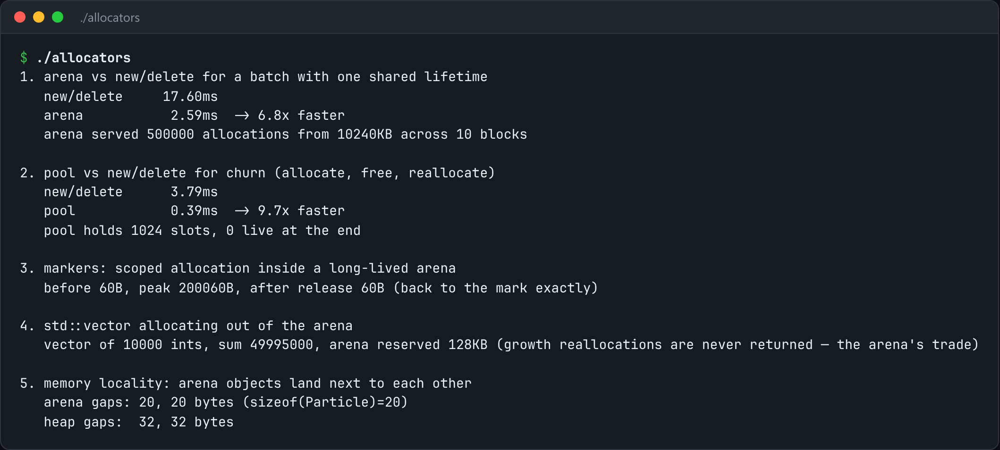

# Arena & Pool Allocators

Two allocators the standard one can't be: a bump arena and a fixed-size pool.



*Real output of `./allocators`.*

## Features

- A **bump arena**: allocation is a pointer add, and freeing is a reset.
- A **fixed-size pool**: allocation pops a free list that is stored inside the free blocks themselves.
- **Benchmarked against `new`/`delete`** for batch lifetimes and for allocate/free churn.
- **Markers** for scoped allocation inside a long-lived arena, and a `std::vector` allocating from the arena.
- Shows **memory locality**: arena objects sit right next to each other.

## How it works

malloc pays for being general: size-class lookups, free-list walks, locking and per-block metadata. When you know the lifetime (use an arena) or the size (use a pool), most of that cost disappears.

## Usage

```bash
g++ -std=c++23 -O2 allocators.cpp -o allocators && ./allocators
```

## Run it

```bash
g++ -std=c++23 -O2 allocators.cpp -o allocators
./allocators
```

Needs a C++23 compiler (GCC 13+ or Clang 17+).

## Files

| File | Purpose |
| --- | --- |
| [`allocators.cpp`](allocators.cpp) | The complete program |
| [`preview.png`](preview.png) | Captured output of a real run |
