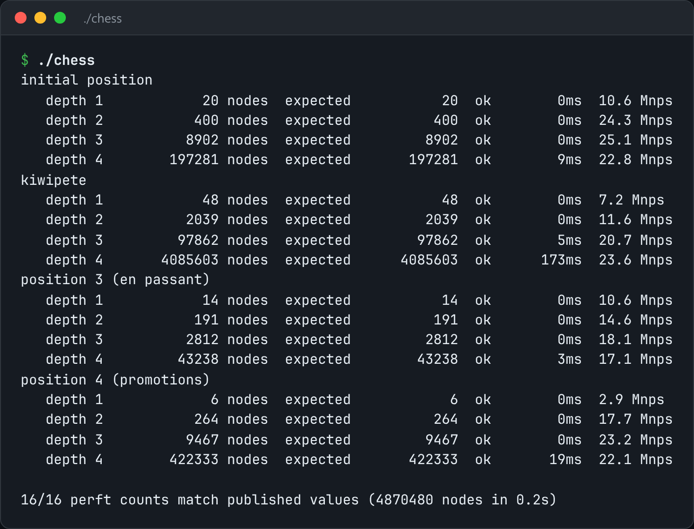

# Bitboard Chess

A legal chess move generator on bitboards, checked against published perft counts.



*Real output of `./chess`.*

## Features

- The board is **twelve 64-bit bitboards**, one per piece type.
- Generates **fully legal moves**: en passant, castling through attacked squares, pins and promotions.
- **Perft** counts leaf nodes to depth N and is compared with published values.
- `--fen` loads any position, such as the "Kiwipete" stress position.

## How it works

"All white pawns that can push" is a shift and an AND, not a loop over 64 squares. Every subtly wrong rule changes the perft count at some depth.

## Usage

```bash
g++ -std=c++23 -O2 chess.cpp -o chess && ./chess --perft 5
./chess --fen "r3k2r/p1ppqpb1/bn2pnp1/3PN3/1p2P3/2N2Q1p/PPPBBPPP/R3K2R w KQkq -" --perft 4
```

## Run it

```bash
g++ -std=c++23 -O2 chess.cpp -o chess
./chess
```

Needs a C++23 compiler (GCC 13+ or Clang 17+).

## Files

| File | Purpose |
| --- | --- |
| [`chess.cpp`](chess.cpp) | The complete program |
| [`preview.png`](preview.png) | Captured output of a real run |
