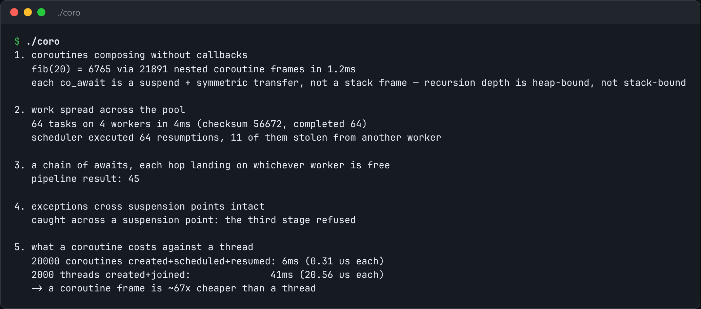

# Coroutine Scheduler

C++20 coroutines on a work-stealing thread pool.



*Real output of `./coro`.*

## Features

- A **`Task<T>`** that composes: awaiting a task resumes the awaiter when the inner task finishes.
- A **scheduler** that owns coroutine handles.
- A **work-stealing pool**: an idle worker steals from a busy worker's deque instead of sleeping.
- **Exceptions cross suspension points** intact.
- Measures the **cost of a coroutine against a thread**.

## How it works

A coroutine is a state machine with a heap-allocated frame, and `co_await` means "save my state and hand my resume handle to whoever I'm waiting on". This supplies the scheduler half.

## Usage

```bash
g++ -std=c++23 -O2 -pthread coro.cpp -o coro && ./coro
```

## Run it

```bash
g++ -std=c++23 -O2 -pthread coro.cpp -o coro
./coro
```

Needs a C++23 compiler (GCC 13+ or Clang 17+).

## Files

| File | Purpose |
| --- | --- |
| [`coro.cpp`](coro.cpp) | The complete program |
| [`preview.png`](preview.png) | Captured output of a real run |
