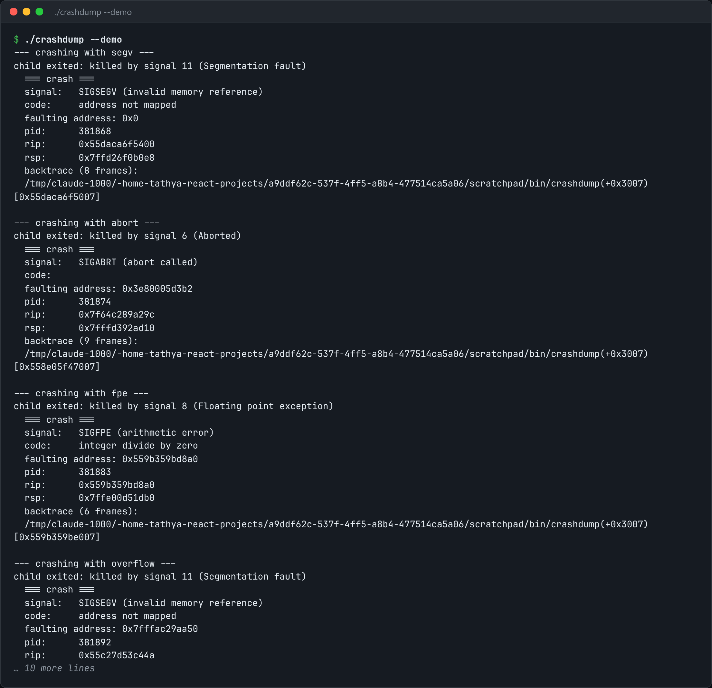

# Crash Handler

A crash handler that survives the crash: async-signal-safe, allocation-free, on its own stack.



*Real output of `./crashdump --demo`.*

## Features

- Uses **only `write()`**: no printf, no malloc.
- Runs on an **alternate signal stack** (`sigaltstack`), so even a stack overflow gets a report.
- Uses **pre-rendered strings**, so nothing is formatted at crash time.
- **Re-raises with the default handler**, so the exit status and core dump stay correct.

## How it works

printf can take a lock the crashing thread already holds, and backtrace_symbols calls malloc, which may be what crashed. These fixes avoid both.

## Usage

```bash
g++ -std=c++23 -O2 -g -rdynamic crashdump.cpp -o crashdump && ./crashdump --demo
```

## Run it

```bash
g++ -std=c++23 -O2 -g -rdynamic crashdump.cpp -o crashdump
./crashdump --demo
```

Needs a C++23 compiler (GCC 13+ or Clang 17+). **Linux only**, because it uses Linux-specific system interfaces.

## Files

| File | Purpose |
| --- | --- |
| [`crashdump.cpp`](crashdump.cpp) | The complete program |
| [`preview.png`](preview.png) | Captured output of a real run |
