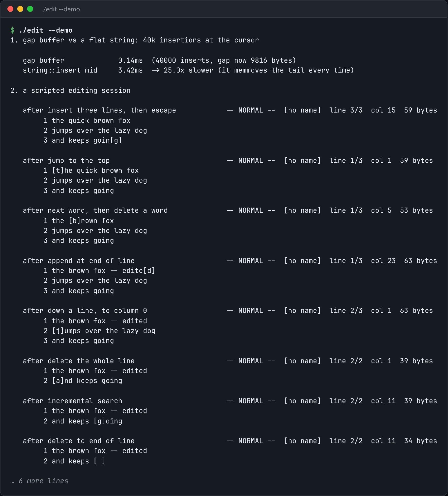

# Modal Text Editor

A modal text editor: raw mode, a gap buffer, vi-style keys, and incremental search.



*Real output of `./edit --demo`.*

## Features

- **Raw terminal mode**, restored exactly as it was, even after a crash.
- A **gap buffer**, so typing at the cursor is O(1).
- **vi-style modal editing** and **incremental search**.
- `--script` drives it without a terminal, which is how the demo runs.

## How it works

A gap buffer keeps an empty gap at the cursor, so inserts never shift the whole file. The cost moves to cursor jumps, which are rare and cheap.

## Usage

```bash
g++ -std=c++23 -O2 edit.cpp -o edit && ./edit file.txt
./edit --script "ihello world\x1b0wdwA!\x1b" --show    # drive it without a terminal
./edit --demo
```

## Run it

```bash
g++ -std=c++23 -O2 edit.cpp -o edit
./edit --demo
```

Needs a C++23 compiler (GCC 13+ or Clang 17+). **Linux only**, because it uses Linux-specific system interfaces.

## Files

| File | Purpose |
| --- | --- |
| [`edit.cpp`](edit.cpp) | The complete program |
| [`preview.png`](preview.png) | Captured output of a real run |
