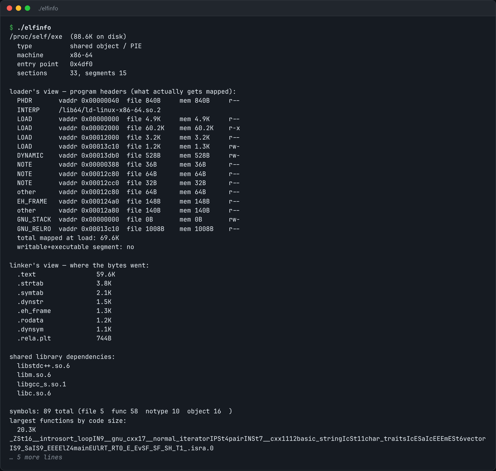

# ELF Inspector

Read an ELF binary the way the loader does: headers, sections, symbols and dependencies.



*Real output of the tool inspecting its own binary: `./elfinfo`.*

## Features

- The **loader's view**: program headers, mapped segments and permissions, and a W^X check.
- The **linker's view**: sections ranked by size.
- Lists **shared library dependencies** (DT_NEEDED).
- A **symbol table** summary, plus the largest functions by code size.

## How it works

An ELF file is two overlapping views of the same bytes. Stripping a binary throws away the linker's view, which is why it still runs but shows nothing useful in a backtrace.

## Usage

```bash
g++ -std=c++23 -O2 elfinfo.cpp -o elfinfo && ./elfinfo ./elfinfo
./elfinfo /bin/ls --symbols --sections
```

## Run it

```bash
g++ -std=c++23 -O2 elfinfo.cpp -o elfinfo
./elfinfo
```

Needs a C++23 compiler (GCC 13+ or Clang 17+).

## Files

| File | Purpose |
| --- | --- |
| [`elfinfo.cpp`](elfinfo.cpp) | The complete program |
| [`preview.png`](preview.png) | Captured output of a real run |
