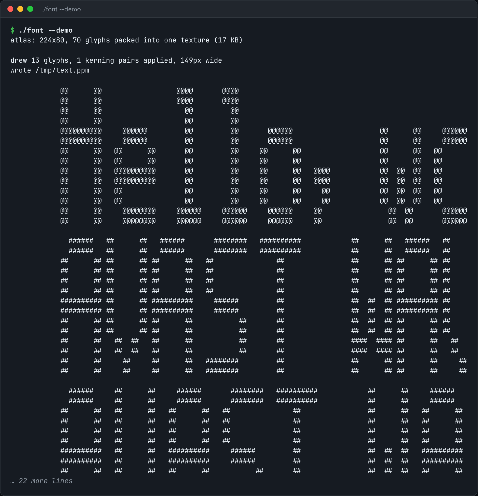

# Glyph Atlas Renderer

Text rendering from first principles: a glyph atlas, kerning, and blitting into a framebuffer.



*Real output of `./font --demo`.*

## Features

- **Packs glyph bitmaps into one atlas texture.**
- Looks up each character's rectangle and **advances the pen by its width plus kerning**.
- **Blits** into a CPU framebuffer and writes a **PPM** you can open.
- A built-in 5x7 font, so it needs no font files.

## How it works

Before shaping engines and hinting, text rendering is exactly this: atlas, advance, kern, blit.

## Usage

```bash
g++ -std=c++23 -O2 font.cpp -o font && ./font --text "Hello, world" --out text.ppm
./font --demo
```

## Run it

```bash
g++ -std=c++23 -O2 font.cpp -o font
./font --demo
```

Needs a C++23 compiler (GCC 13+ or Clang 17+).

## Files

| File | Purpose |
| --- | --- |
| [`font.cpp`](font.cpp) | The complete program |
| [`preview.png`](preview.png) | Captured output of a real run |
