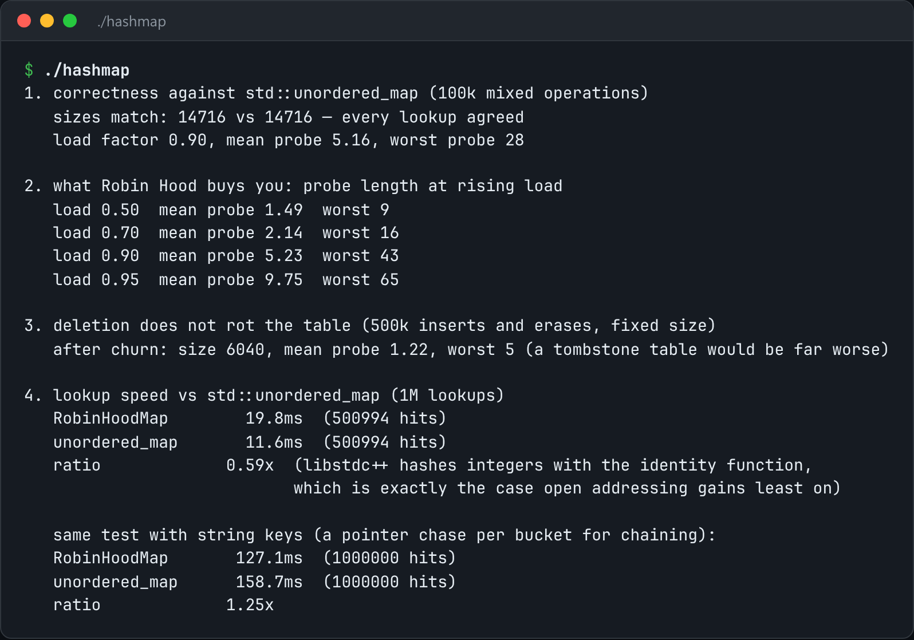

# Robin Hood Hash Map

An open-addressing hash map with Robin Hood probing and backward-shift deletion.



*Real output of `./hashmap`.*

## Features

- **Open addressing** keeps everything in one array, which is friendly to the cache.
- **Robin Hood probing**: a key that has probed further takes the slot from one that has probed less.
- **Backward-shift deletion** instead of tombstones.
- Benchmarked against `std::unordered_map`.

## How it works

Robin Hood flattens the worst-case probe length. Backward shifting means a delete-heavy workload doesn't slowly fill with tombstones.

## Usage

```bash
g++ -std=c++23 -O2 hashmap.cpp -o hashmap && ./hashmap
```

## Run it

```bash
g++ -std=c++23 -O2 hashmap.cpp -o hashmap
./hashmap
```

Needs a C++23 compiler (GCC 13+ or Clang 17+).

## Files

| File | Purpose |
| --- | --- |
| [`hashmap.cpp`](hashmap.cpp) | The complete program |
| [`preview.png`](preview.png) | Captured output of a real run |
