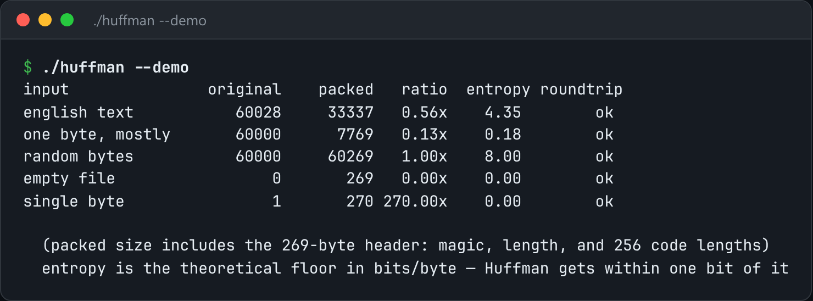

# Huffman Coding

Huffman coding end to end: build the tree, pack the bits, and verify the round trip.



*Real output of `./huffman --demo`.*

## Features

- Builds the tree from symbol frequencies.
- **Canonical codes**: the header stores only each symbol's code length.
- **Bit packing** with a record of how many bits of the final byte are real.
- `compress`, `decompress`, and a demo that checks the round trip.

## How it works

Codes aren't byte-aligned. Without the count of valid bits in the last byte, decoding reads into the padding and emits phantom symbols.

## Usage

```bash
g++ -std=c++23 -O2 huffman.cpp -o huffman
./huffman compress input.txt out.huf && ./huffman decompress out.huf back.txt
./huffman --demo
```

## Run it

```bash
g++ -std=c++23 -O2 huffman.cpp -o huffman
./huffman --demo
```

Needs a C++23 compiler (GCC 13+ or Clang 17+).

## Files

| File | Purpose |
| --- | --- |
| [`huffman.cpp`](huffman.cpp) | The complete program |
| [`preview.png`](preview.png) | Captured output of a real run |
