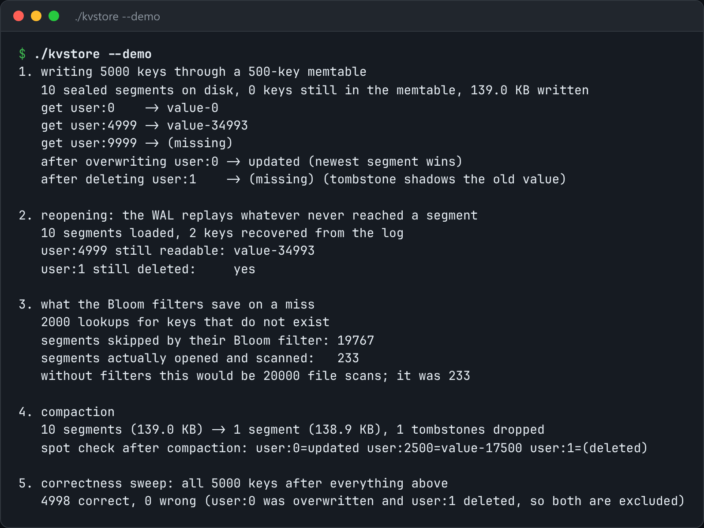

# LSM Key-Value Store

A log-structured key-value store: memtable, WAL, sorted segment files, compaction.



*Real output of `./kvstore --demo`.*

## Features

- Writes **only ever append**: first to a WAL, then to sorted segment files.
- Each segment has a **Bloom filter** and a **sparse index**, so a miss is cheap.
- Deletes are **tombstones**. **Compaction** finally drops them.
- A CLI with `put` and `get` against a data directory.

## How it works

The LSM bargain: random writes become sequential ones, and reads pay for it by checking the newest segment first, then older ones.

## Usage

```bash
g++ -std=c++23 -O2 kvstore.cpp -o kvstore && ./kvstore --demo
./kvstore ./data put user:1 ana && ./kvstore ./data get user:1
```

## Run it

```bash
g++ -std=c++23 -O2 kvstore.cpp -o kvstore
./kvstore --demo
```

Needs a C++23 compiler (GCC 13+ or Clang 17+).

## Files

| File | Purpose |
| --- | --- |
| [`kvstore.cpp`](kvstore.cpp) | The complete program |
| [`preview.png`](preview.png) | Captured output of a real run |
