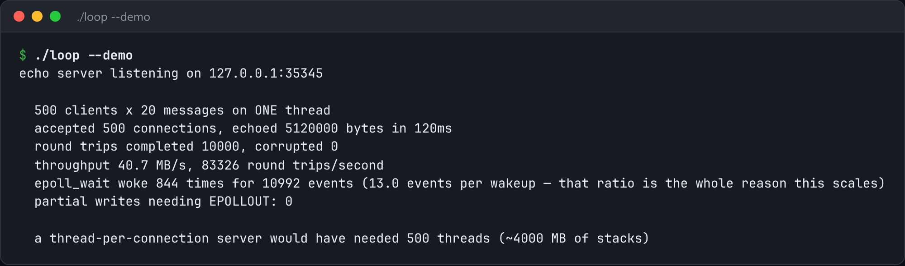

# epoll Event Loop

One thread, thousands of connections: an edge-triggered epoll loop with timers.



*Real output of `./loop --demo`.*

## Features

- **Edge-triggered** epoll that drains each socket until EAGAIN.
- **Non-blocking** sockets everywhere, so one slow client can't stall the rest.
- **Output buffers plus EPOLLOUT** for partial writes.
- **timerfd** timers on the same loop. `--port` runs an echo server.

## How it works

Edge-triggered mode reports a file descriptor once per change. If you don't drain it, you hang forever holding unread bytes.

## Usage

```bash
g++ -std=c++23 -O2 loop.cpp -o loop && ./loop --demo
./loop --port 8080          # an echo server you can telnet into
```

## Run it

```bash
g++ -std=c++23 -O2 loop.cpp -o loop
./loop --demo
```

Needs a C++23 compiler (GCC 13+ or Clang 17+). **Linux only**, because it uses Linux-specific system interfaces.

## Files

| File | Purpose |
| --- | --- |
| [`loop.cpp`](loop.cpp) | The complete program |
| [`preview.png`](preview.png) | Captured output of a real run |
