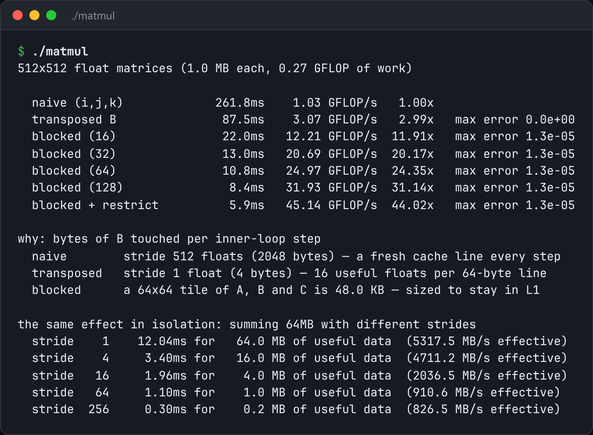

# Matrix Multiply, Four Ways

The same matrix multiply four ways, and how the memory hierarchy explains the gap.



*Real timings for N=512 on this machine: `./matmul`.*

## Features

- **Naive**: B is walked down a column, so every step loads a new cache line.
- **Transposed**: B is stored column-major, so both operands stream.
- **Blocked**: tiles that fit in L1 reuse each loaded line many times.
- **Blocked + restrict**: an inner loop the compiler can vectorise.
- Several tile sizes, plus a **stride experiment** that isolates the cache-line effect.

## How it works

All four do exactly 2·N³ floating-point operations. Only the order they touch memory changes, and that is the whole performance story.

## Usage

```bash
g++ -std=c++23 -O3 -march=native matmul.cpp -o matmul && ./matmul 512
```

## Run it

```bash
g++ -std=c++23 -O3 -march=native matmul.cpp -o matmul
./matmul
```

Needs a C++23 compiler (GCC 13+ or Clang 17+).

## Files

| File | Purpose |
| --- | --- |
| [`matmul.cpp`](matmul.cpp) | The complete program |
| [`preview.png`](preview.png) | Captured output of a real run |
