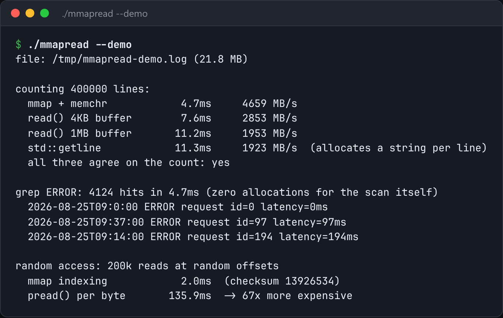

# mmap Line Reader

mmap a file and iterate over its lines, measured against buffered reads.



*Real output of `./mmapread --demo`.*

## Features

- Iterates lines straight from **mapped pages**, with no `read()` per block and no copy.
- A **benchmark against buffered reads**.
- `--grep` scans without allocating.
- Explains the costs: SIGBUS on truncation and page faults on cold random access.

## How it works

mmap turns file access into page faults. The pages you touch are shared with the page cache, not duplicated.

## Usage

```bash
g++ -std=c++23 -O2 mmapread.cpp -o mmapread && ./mmapread --demo
./mmapread bigfile.log --grep ERROR
```

## Run it

```bash
g++ -std=c++23 -O2 mmapread.cpp -o mmapread
./mmapread --demo
```

Needs a C++23 compiler (GCC 13+ or Clang 17+). **Linux only**, because it uses Linux-specific system interfaces.

## Files

| File | Purpose |
| --- | --- |
| [`mmapread.cpp`](mmapread.cpp) | The complete program |
| [`preview.png`](preview.png) | Captured output of a real run |
