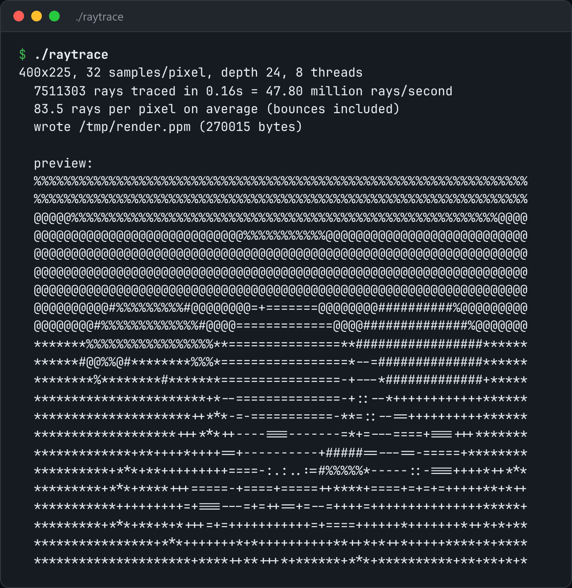

# Path Tracer

A path tracer: spheres, three materials, anti-aliasing, threads, and PPM output.



*Real output of `./raytrace`.*

## Features

- **Diffuse, metal and glass** materials, including refraction with total internal reflection.
- **Soft shadows** and **colour bleeding** that come from the sampling, not special cases.
- **Anti-aliasing** with multiple samples per pixel.
- **Multithreaded** rendering to a PPM.

## How it works

Every pixel fires rays that bounce until they hit a light or run out of depth, and the results are averaged. All the realism falls out of random directions and each material's scatter rule.

## Usage

```bash
g++ -std=c++23 -O3 -march=native -pthread raytrace.cpp -o raytrace
./raytrace --width 600 --samples 64 --out render.ppm
```

## Run it

```bash
g++ -std=c++23 -O3 -march=native -pthread raytrace.cpp -o raytrace
./raytrace
```

Needs a C++23 compiler (GCC 13+ or Clang 17+).

## Files

| File | Purpose |
| --- | --- |
| [`raytrace.cpp`](raytrace.cpp) | The complete program |
| [`preview.png`](preview.png) | Captured output of a real run |
