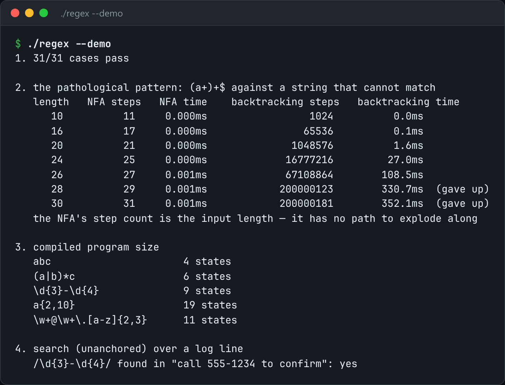

# Thompson NFA Regex

A regex engine that can't blow up: parse to a tree, compile to an NFA, and simulate it.



*Real output of `./regex --demo`.*

## Features

- **Thompson simulation** advances every live state at once, one character at a time.
- **O(text × pattern)** for any pattern, so `(a+)+$` stays linear.
- Supports literals, `.`, `\d \w \s`, character classes, `* + ?`, `|`, groups, `{m,n}`, `^` and `$`.

## How it works

Backtracking engines try one path at a time and unwind, which is exponential on bad patterns. The state set here is bounded by the size of the pattern.

## Usage

```bash
g++ -std=c++23 -O2 regex.cpp -o regex && ./regex --demo
./regex '^a(b|c)*d+$' abcbcddd
```

## Run it

```bash
g++ -std=c++23 -O2 regex.cpp -o regex
./regex --demo
```

Needs a C++23 compiler (GCC 13+ or Clang 17+).

## Files

| File | Purpose |
| --- | --- |
| [`regex.cpp`](regex.cpp) | The complete program |
| [`preview.png`](preview.png) | Captured output of a real run |
