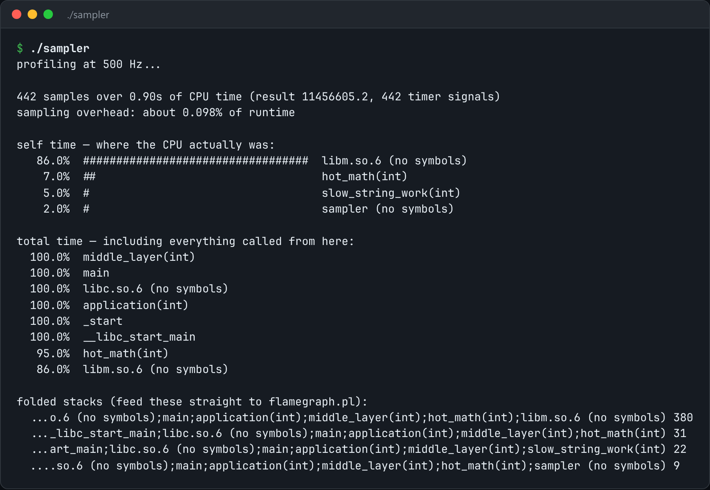

# Sampling Profiler

A sampling profiler: interrupt on a timer, walk the stack, and fold the samples into a flame graph.



*Real output of `./sampler`.*

## Features

- A **profiling timer signal** fires a few hundred times a second.
- The handler does only `backtrace()` into a **preallocated buffer**.
- **Symbols are resolved later**, off the hot path.
- Writes **folded stacks** for flame-graph tools.

## How it works

Instrumentation distorts small, hot functions the most. Sampling has a fixed, tiny cost and converges on where the time actually goes.

## Usage

```bash
g++ -std=c++23 -O2 -g -rdynamic -pthread sampler.cpp -o sampler && ./sampler
```

## Run it

```bash
g++ -std=c++23 -O2 -g -rdynamic -pthread sampler.cpp -o sampler
./sampler
```

Needs a C++23 compiler (GCC 13+ or Clang 17+). **Linux only**, because it uses Linux-specific system interfaces.

## Files

| File | Purpose |
| --- | --- |
| [`sampler.cpp`](sampler.cpp) | The complete program |
| [`preview.png`](preview.png) | Captured output of a real run |
