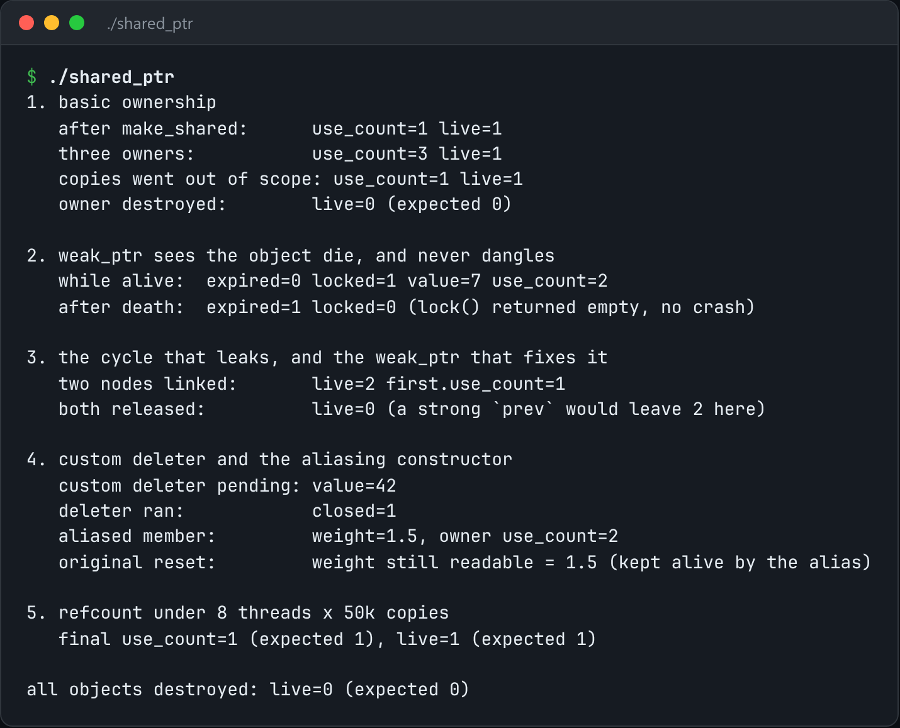

# shared_ptr from Scratch

A shared pointer built from scratch: atomic refcounts, weak refs, aliasing, custom deleters.



*Real output of `./shared_ptr`.*

## Features

- A **control block** with separate **strong** and **weak** counts.
- **Safe upgrade** from weak to strong: it can never touch freed memory.
- **Aliasing** constructor and **custom deleters**.
- Atomic counts, **tested across threads**.

## How it works

Strong references own the object, and weak references own the control block. The block is freed only when the weak count (which all strong references together hold one of) reaches zero.

## Usage

```bash
g++ -std=c++23 -O2 -pthread shared_ptr.cpp -o shared_ptr && ./shared_ptr
```

## Run it

```bash
g++ -std=c++23 -O2 -pthread shared_ptr.cpp -o shared_ptr
./shared_ptr
```

Needs a C++23 compiler (GCC 13+ or Clang 17+).

## Files

| File | Purpose |
| --- | --- |
| [`shared_ptr.cpp`](shared_ptr.cpp) | The complete program |
| [`preview.png`](preview.png) | Captured output of a real run |
