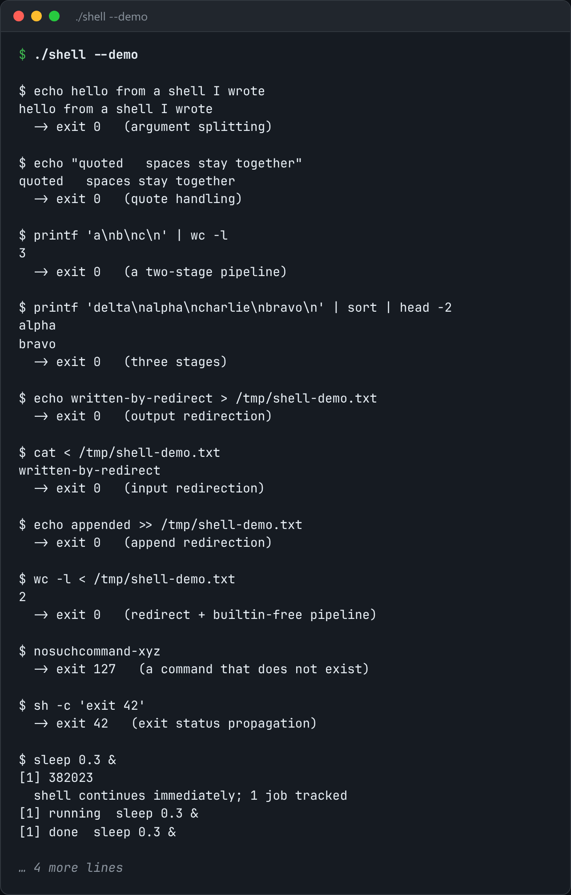

# Unix Shell

A shell: tokenizing, fork/exec, pipelines, redirection, background jobs, signals.



*Real output of `./shell --demo`.*

## Features

- **Pipelines**: all N-1 pipes are created up front, and every unused end is closed in every process.
- **Redirection** of standard input, output and error.
- **Background jobs** in their own process groups, so Ctrl-C reaches only the foreground job.
- **Terminal hand-off** with `tcsetpgrp`.
- `--run` runs one command line.

## How it works

Miss one pipe close and the reader never sees EOF. Skip `tcsetpgrp` and interactive programs are stopped by SIGTTIN when they read.

## Usage

```bash
g++ -std=c++23 -O2 shell.cpp -o shell && ./shell
./shell --run "ls /etc | grep conf | wc -l"
./shell --demo
```

## Run it

```bash
g++ -std=c++23 -O2 shell.cpp -o shell
./shell --demo
```

Needs a C++23 compiler (GCC 13+ or Clang 17+). **Linux only**, because it uses Linux-specific system interfaces.

## Files

| File | Purpose |
| --- | --- |
| [`shell.cpp`](shell.cpp) | The complete program |
| [`preview.png`](preview.png) | Captured output of a real run |
