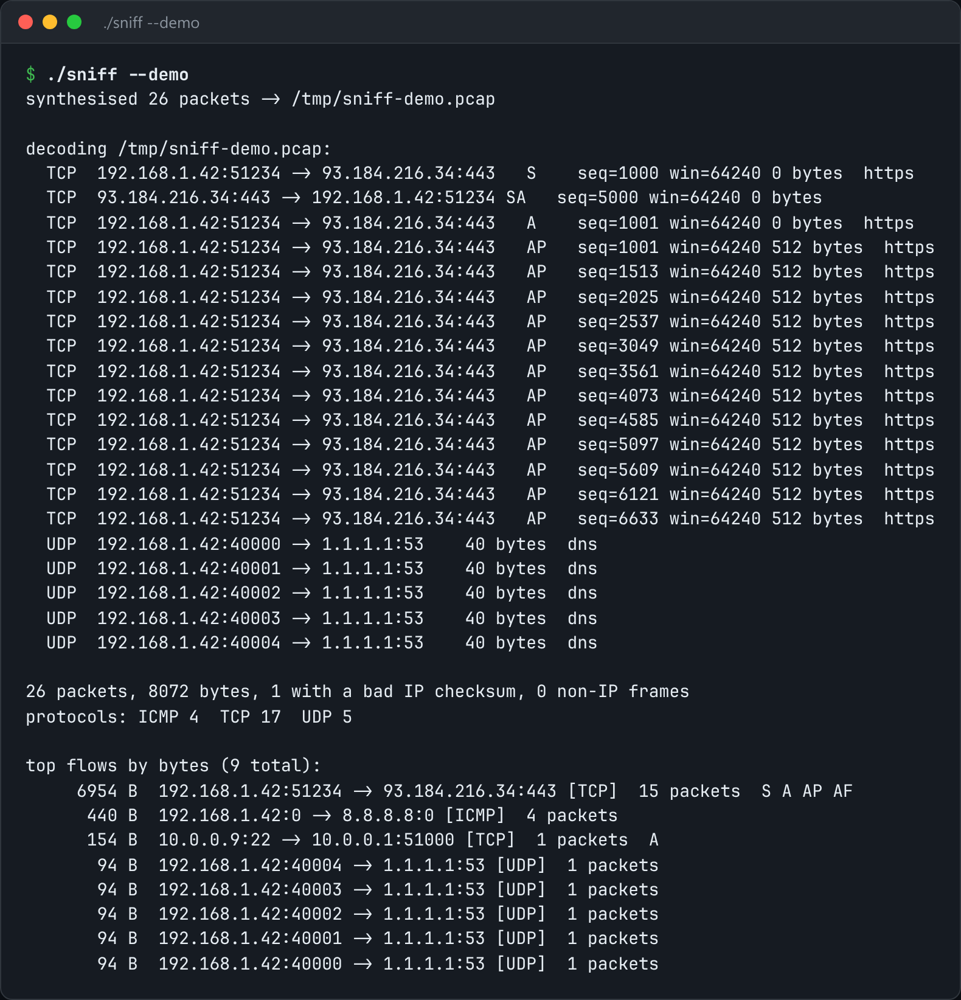

# Packet Sniffer

Decode network traffic byte by byte: Ethernet, IP, TCP/UDP/ICMP, plus per-flow stats.



*Real output of `./sniff --demo`.*

## Features

- Decodes **Ethernet → IPv4 → TCP/UDP/ICMP** headers by hand.
- **Verifies checksums** with the one's-complement sum and carry folding.
- **Per-flow statistics.**
- Live capture (needs `CAP_NET_RAW`), **pcap files**, or `--demo`, which builds a capture itself.

## How it works

Each header says what follows it. The hard parts are details such as IHL being in 4-byte words and TCP's data offset sitting in the high nibble.

## Usage

```bash
sudo ./sniff --iface any --count 50        # live capture needs CAP_NET_RAW
./sniff --pcap capture.pcap                # or read a pcap file, no privileges
./sniff --demo                             # synthesises a capture, then decodes it
```

## Run it

```bash
g++ -std=c++23 -O2 sniff.cpp -o sniff
./sniff --demo
```

Needs a C++23 compiler (GCC 13+ or Clang 17+). **Linux only**, because it uses Linux-specific system interfaces.

## Files

| File | Purpose |
| --- | --- |
| [`sniff.cpp`](sniff.cpp) | The complete program |
| [`preview.png`](preview.png) | Captured output of a real run |
