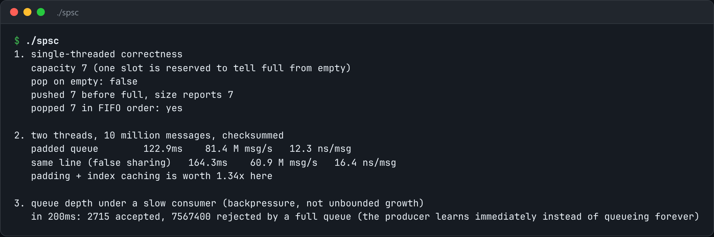

# SPSC Ring Buffer

A lock-free single-producer, single-consumer ring buffer, with a test that it is correct.



*Real output of `./spsc`.*

## Features

- **Two atomics with one owner each**, published with release/acquire ordering.
- Indices on **separate cache lines** to avoid false sharing.
- Each side **caches the other's index** and re-reads it only when the ring looks empty or full.
- A **stress test** checks ordering and integrity across threads.

## How it works

Get the cache-line separation wrong and every push invalidates the consumer's line. That is the difference between fast and a disaster.

## Usage

```bash
g++ -std=c++23 -O2 -pthread spsc.cpp -o spsc && ./spsc
```

## Run it

```bash
g++ -std=c++23 -O2 -pthread spsc.cpp -o spsc
./spsc
```

Needs a C++23 compiler (GCC 13+ or Clang 17+).

## Files

| File | Purpose |
| --- | --- |
| [`spsc.cpp`](spsc.cpp) | The complete program |
| [`preview.png`](preview.png) | Captured output of a real run |
