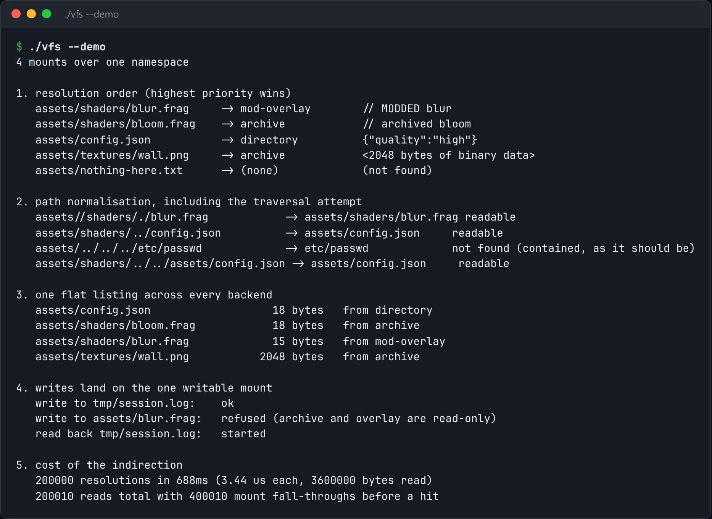

# Virtual File System

One path namespace over many backends: real directories, packed archives, memory, and overlays.



*Real output of `./vfs --demo`.*

## Features

- A **mount table** with a **resolution order**.
- Backends for **directories**, **packed archives** (one blob plus an index) and **memory**, plus **overlays**.
- **Path normalisation**: `..` can never escape a mount root.
- **Mount precedence**, so a mod overlay wins over the base assets.

## How it works

Code opens `shaders/blur.frag` without caring whether it lives in a folder, a packed archive, or an overlay a mod dropped on top.

## Usage

```bash
g++ -std=c++23 -O2 vfs.cpp -o vfs && ./vfs --demo
```

## Run it

```bash
g++ -std=c++23 -O2 vfs.cpp -o vfs
./vfs --demo
```

Needs a C++23 compiler (GCC 13+ or Clang 17+).

## Files

| File | Purpose |
| --- | --- |
| [`vfs.cpp`](vfs.cpp) | The complete program |
| [`preview.png`](preview.png) | Captured output of a real run |
