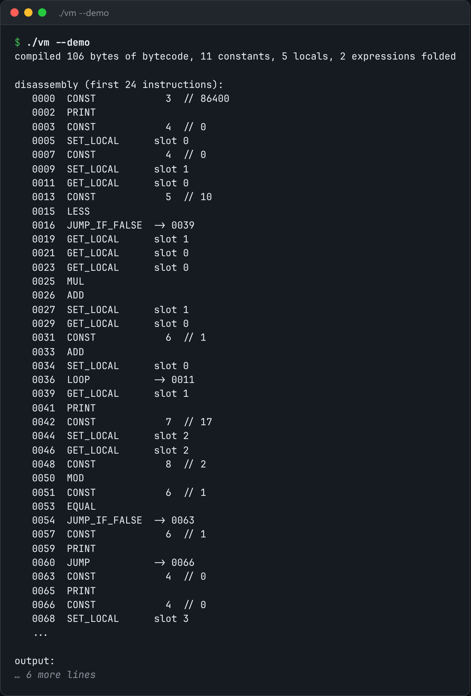

# Bytecode VM

A stack VM with its own compiler: source → bytecode → execution, plus a disassembler.



*Real output of `./vm --demo`.*

## Features

- A **single-pass compiler** that emits bytecode as it parses, with no AST.
- **Jump patching** for forward branches.
- **Constant folding** while compiling.
- **Call frames** with locals addressed by slot.
- `--disasm` prints the bytecode.

## How it works

A tree-walking interpreter re-inspects the AST on every step. A VM does that work once and leaves a flat instruction array behind.

## Usage

```bash
g++ -std=c++23 -O2 vm.cpp -o vm && ./vm --demo
./vm program.toy --disasm
```

## Run it

```bash
g++ -std=c++23 -O2 vm.cpp -o vm
./vm --demo
```

Needs a C++23 compiler (GCC 13+ or Clang 17+).

## Files

| File | Purpose |
| --- | --- |
| [`vm.cpp`](vm.cpp) | The complete program |
| [`preview.png`](preview.png) | Captured output of a real run |
