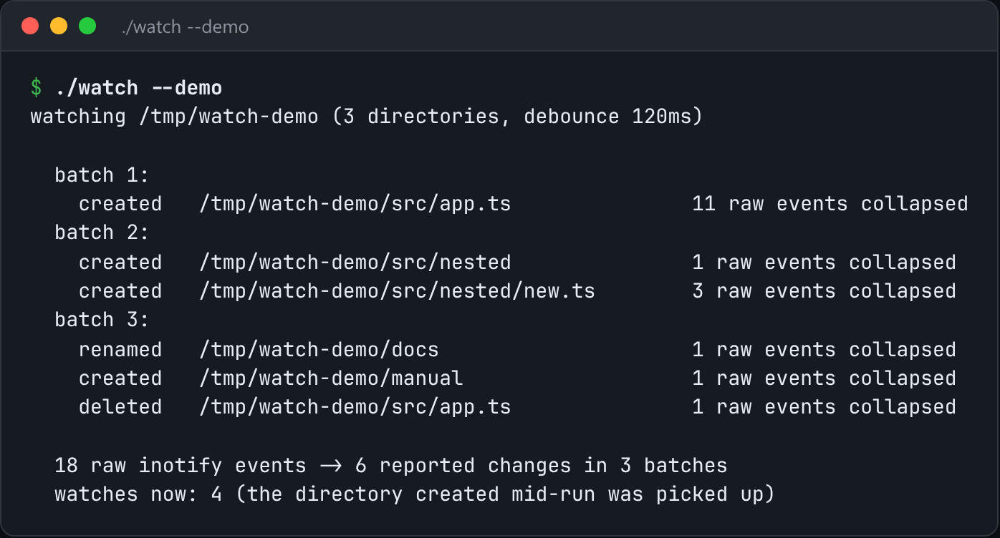

# inotify Watcher

Watch a directory tree with inotify: recursive, coalescing, with a debounced callback.



*Real output of `./watch --demo`.*

## Features

- **Recursive watches**, including **directories created while it runs**.
- **Coalesces events per path** within a debounce window.
- One editor save (CREATE, MODIFY, MOVED_FROM, MOVED_TO, DELETE) becomes **one change**.
- `--demo` creates a temporary tree and changes it.

## How it works

Naive watchers miss everything under a newly cloned folder, because the folder didn't exist when the watches were set up. New directories are watched as soon as they appear.

## Usage

```bash
g++ -std=c++23 -O2 watch.cpp -o watch && ./watch ./src --debounce 200
./watch --demo          # creates a temp tree and drives it itself
```

## Run it

```bash
g++ -std=c++23 -O2 watch.cpp -o watch
./watch --demo
```

Needs a C++23 compiler (GCC 13+ or Clang 17+). **Linux only**, because it uses Linux-specific system interfaces.

## Files

| File | Purpose |
| --- | --- |
| [`watch.cpp`](watch.cpp) | The complete program |
| [`preview.png`](preview.png) | Captured output of a real run |
