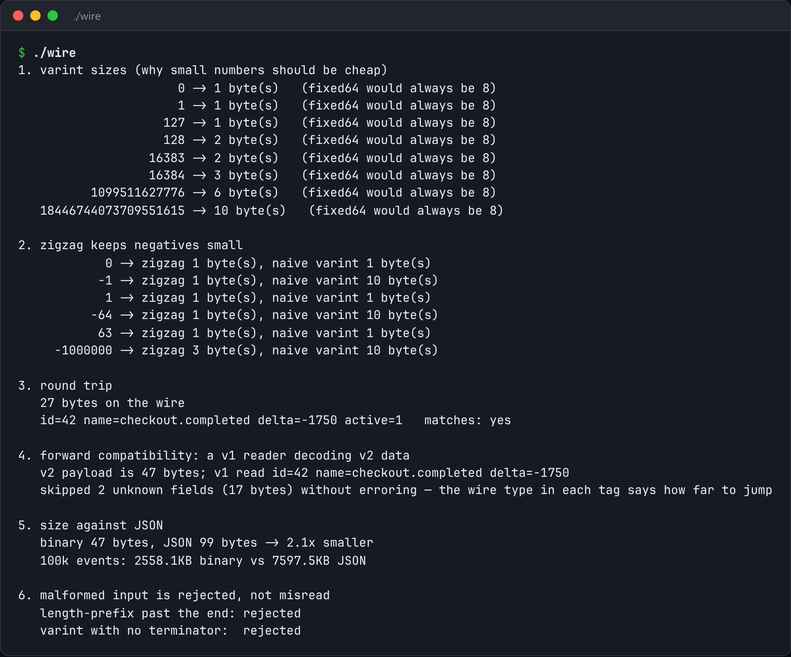

# Binary Wire Format

A binary wire format: varints, zigzag, a schema header, and forward-compatible decoding.



*Real output of `./wire`.*

## Features

- **Varints**: a small number costs one byte.
- **Zigzag** encoding, so -1 is 1 rather than ten bytes of sign bits.
- A **wire type in each tag**, so any field can be skipped.
- **Unknown fields are kept**, not rejected, so rollouts are safe.

## How it works

Old readers survive new writers because they can skip fields they don't know and pass them through unchanged.

## Usage

```bash
g++ -std=c++23 -O2 wire.cpp -o wire && ./wire
```

## Run it

```bash
g++ -std=c++23 -O2 wire.cpp -o wire
./wire
```

Needs a C++23 compiler (GCC 13+ or Clang 17+).

## Files

| File | Purpose |
| --- | --- |
| [`wire.cpp`](wire.cpp) | The complete program |
| [`preview.png`](preview.png) | Captured output of a real run |
